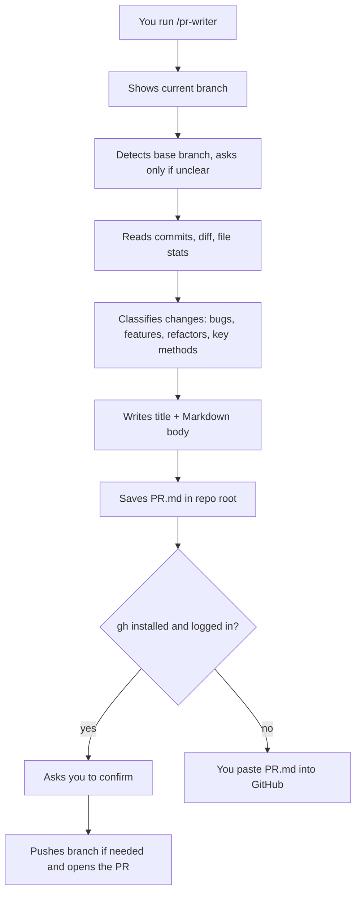

# What pr-writer Does

`pr-writer` reads your current git branch and writes a complete, well-formatted pull request description. You review it, and it can optionally open the PR on GitHub for you.

## The problem it solves

Good PR descriptions take time, so most are one line long. Reviewers then have to read the whole diff to guess what changed and why. `pr-writer` does that reading for you and turns it into a structured summary.

## How it works



1. **Confirms the branch.** It always checks the branch you are on right now, so it never describes the wrong one.
2. **Finds the base branch.** It detects it (open PR, then repo default) and asks only if unclear. Pass `base <branch>` to set it.
3. **Gathers facts.** Commit messages, the diff against the base (only this branch's changes), file and line counts, and uncommitted work (reported separately, since it is not in the PR).
4. **Classifies every change** into bug fixes, new features, refactors, key methods and components, and dependency or config changes.
5. **Writes the PR.** Title under 70 characters, body in GitHub-flavored Markdown.
6. **Saves and optionally creates the PR.**

## What the output looks like

| Section | Content |
|---|---|
| TL;DR callout | One line: what and why |
| Stats table | Branch, base, commit count, files, +/- lines |
| Summary | 2-4 plain sentences |
| Bug fixes | Table: bug, cause, fix, file |
| New features | What users can now do, and where |
| Key methods & components | Table of new or changed functions, hooks, components |
| Flow | A mermaid diagram, only when a real flow needs explaining |
| File changes | Collapsible sections per area |
| Notable diffs | 1-3 before/after snippets |
| Breaking changes | Warning callout, or "None" |
| Notes for reviewers | Risky areas, tradeoffs, leftovers |
| Test plan | Checklist reviewers can follow |

Empty sections are skipped, so small PRs stay short.

## Flags

| Flag | Effect |
|---|---|
| `base <branch>` | Use this base branch, skip detection |
| `--draft` | Create the PR as a draft |
| `--no-create` | Only write `PR.md`; never push or create |
| `--short` | Short description |
| `--update` | Update the existing PR with `gh pr edit` |
| `--lang <language>` | Write in another language |
| `--run-tests` | Run the project's tests and report the real result |

## Smart behavior

- **Base branch** is auto-detected (open PR, then the repo default branch) and asked only when unclear.
- **Repo PR template** (`.github/pull_request_template.md`) is used if present.
- **Noise is excluded** from the diff: lockfiles, minified, generated and snapshot files.
- **Title style** follows your recent commits (Conventional Commits or plain).
- **Ticket and issue links** come from the branch name and commits.
- **Breaking-change check**: signatures, migrations, env vars, removed files, major dependency bumps.
- **Safety scan**: leftover debug logs, TODOs, possible secrets (value never printed).
- **Reviewers** are suggested from `CODEOWNERS`.

## Principles

- **Evidence only.** Every claim must come from the diff or commit messages. If intent is unclear, it says "appears to" or leaves it out. Bugs are never invented.
- **Plain language.** Short sentences, and terms explained on first use.
- **Flags problems.** Leftover `console.log`, `TODO`s, commented-out code, secrets and missing tests are listed under reviewer notes.
- **No attribution lines.** It never adds a "Generated with Claude Code" line to the title or body.

## Usage

```
/pr-writer
/pr-writer base main
/pr-writer PROJ-123 login timeout fix
```

You can also ask in plain words: "write a PR description for this branch".

Anything after `/pr-writer` is treated as optional ticket or context text. Naming a base branch there skips the base-branch question.

## What it touches

- **Reads:** git history and diff of the current repo.
- **Writes:** `PR.md` in the repo root.
- **Runs `git push` and `gh pr create`** only after you confirm, and only if `gh` is installed and logged in. It pushes the branch when it has no upstream.

Add `PR.md` to `.gitignore` if you do not want to commit it.

## Limits

- It only sees committed changes. Uncommitted work is mentioned but not described.
- Very large diffs: it reads the biggest, most important files in full and may summarise the rest.
- Descriptions are drafts. Read them before submitting, especially the bug-fix claims.
